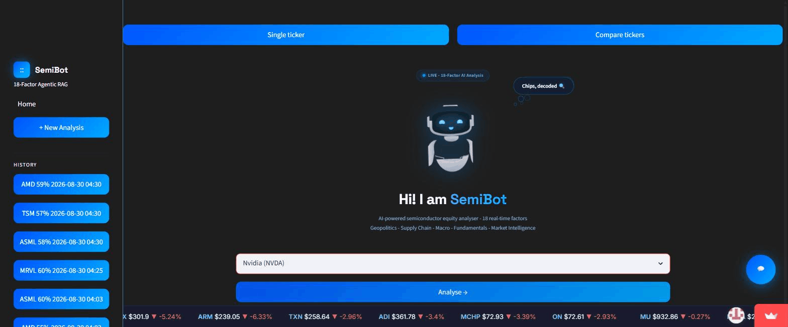

# SemiBot

18-factor agentic RAG system for semiconductor equity prediction, built with LangGraph and retrieval-augmented generation over market and fundamentals data.

**Live app:** https://semibot-raj.streamlit.app/

## Key results
Backtest across 48 semiconductor tickers x 10 dates (480 combinations; 426 valid, 54 skipped for insufficient price history to compute the 200-day moving average). Raw results are in `tools/backtest2_final_results.json`; the regression is reproduced by `verify_regression.py` (run from the repo root).

| Market-cap tier | Valid predictions | Correct | Accuracy |
|---|---|---|---|
| > $1T | 50 | 42 | 84.0% |
| Mid-cap ($2B-$10B) | 72 | 30 | 41.7% |
| All tiers | 426 | 261 | 61.3% |

Accuracy rises with market capitalisation (logistic regression on log market cap, p<0.001). Research paper: SSRN 7199998 (under review).

## Demo


## Stack
- Streamlit (frontend)
- LangGraph (agent orchestration)
- RAG pipeline over semiconductor sector data
- SQLite (checkpointing / factor cache)

## Architecture

```mermaid
flowchart TD
    START([START]) --> fetch_macro
    START --> fetch_fundamental
    START --> fetch_market
    START --> fetch_external

    subgraph fetch_macro[Macro Subgraph]
        direction TB
        m_start([START]) --> fetch_cpi
        m_start --> fetch_ppi
        m_start --> fetch_fed_rate
        m_start --> fetch_usd_index
        fetch_cpi --> m_end([END])
        fetch_ppi --> m_end
        fetch_fed_rate --> m_end
        fetch_usd_index --> m_end
    end

    subgraph fetch_fundamental[Fundamental Subgraph]
        direction TB
        f_start([START]) --> fetch_pe_ratio
        f_start --> fetch_market_cap
        f_start --> fetch_earnings_guidance
        f_start --> fetch_insider_selling
        fetch_pe_ratio --> f_end([END])
        fetch_market_cap --> f_end
        fetch_earnings_guidance --> f_end
        fetch_insider_selling --> f_end
    end

    subgraph fetch_market[Market Subgraph]
        direction TB
        mk_start([START]) --> fetch_sector_rally
        mk_start --> fetch_technical_signal
        mk_start --> fetch_analyst_ratings
        mk_start --> fetch_sell_the_news
        fetch_sector_rally --> mk_end([END])
        fetch_technical_signal --> mk_end
        fetch_analyst_ratings --> mk_end
        fetch_sell_the_news --> mk_end
    end

    subgraph fetch_external[External Subgraph]
        direction TB
        e_start([START]) --> fetch_geopolitics
        e_start --> fetch_news_sentiment
        e_start --> fetch_capital_rotation
        e_start --> fetch_competitor_contagion
        e_start --> fetch_beta
        e_start --> fetch_supply_chain
        fetch_geopolitics --> e_end([END])
        fetch_news_sentiment --> e_end
        fetch_capital_rotation --> e_end
        fetch_competitor_contagion --> e_end
        fetch_beta --> e_end
        fetch_supply_chain --> e_end
    end

    fetch_macro --> generate_prediction[generate_prediction]
    fetch_fundamental --> generate_prediction
    fetch_market --> generate_prediction
    fetch_external --> generate_prediction
    generate_prediction --> END([END])
```


## Run locally
```bash
pip install -r requirements.txt
streamlit run frontend/app.py
```
